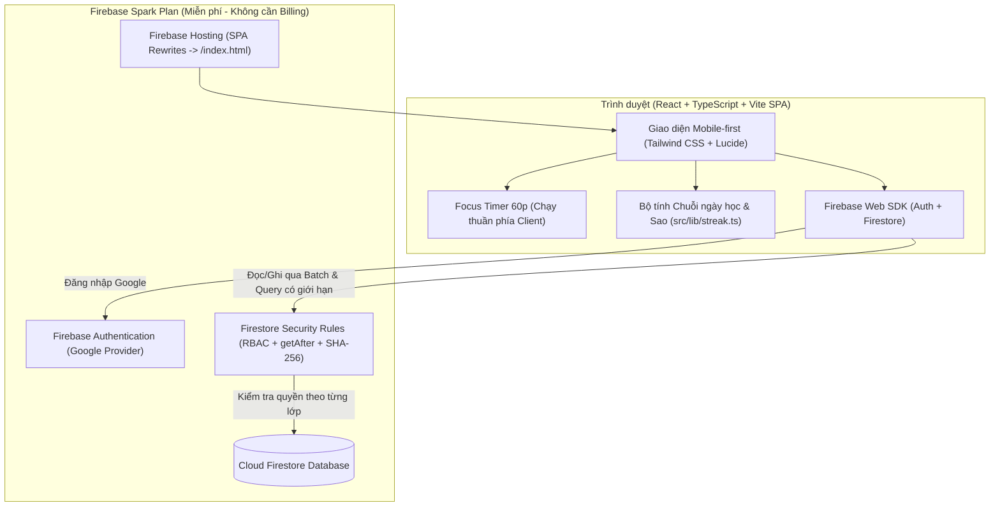

# StudyNest – Góc học tập 60 phút mỗi tối

**StudyNest** là ứng dụng web MVP hỗ trợ anh/chị, phụ huynh và giáo viên đồng hành cùng học sinh tiểu học (đặc biệt là học sinh lớp 3) theo nhịp học tập **60 phút mỗi tối** tại nhà, đồng thời mở rộng linh hoạt cho mô hình **nhiều lớp học – nhiều người hướng dẫn – nhiều học sinh** hoàn toàn trên gói miễn phí **Firebase Spark (Free Plan)**.

---

## 1. Sơ đồ kiến trúc & Luồng dữ liệu

Ứng dụng tuân thủ nghiêm ngặt kiến trúc **Serverless SPA trên Firebase Spark** (không dùng Cloud Functions, không Cloud Run, không tự dựng API backend, không phụ thuộc Cloud Storage trả phí). Toàn bộ phân quyền và toàn vẹn dữ liệu được cưỡng chế trực tiếp tại **Firestore Security Rules (`firestore.rules`)**.



---

## 2. Mô hình dữ liệu Cloud Firestore & Chỉ mục (Indexes)

| Đường dẫn tài liệu (Document Path) | Mục đích & Thiết kế tối ưu hạn mức Spark |
| :--- | :--- |
| `users/{uid}` | Hồ sơ tối thiểu (`uid`, `displayName`, `photoURL`). Chỉ chủ tài khoản mới đọc/ghi được (`isUser(uid)`), bảo vệ dữ liệu học sinh nhỏ tuổi. |
| `classes/{classId}` | Thông tin lớp học, màu sắc, biểu tượng, múi giờ (`Asia/Ho_Chi_Minh`) và `studyDaysOfWeek` (cấu hình ngày học trong tuần để tính Streak). |
| `classes/{classId}/members/{uid}` | Phân quyền theo từng lớp: `owner`, `instructor`, `student`. Hỗ trợ **Collection Group Query** trên `members` (`uid == auth.uid && status == 'active'`) để lấy danh sách *"Lớp của tôi"* mà không bao giờ quét toàn bộ `classes`. |
| `classes/{classId}/invitations/{invitationId}` | Lời mời tham gia lớp với `invitationId` ngẫu nhiên 142-bit entropy và `codeHash` (SHA-256 của `${invitationId}:${joinCode}`). **Tuyệt đối không lưu mã tham gia dạng plaintext**. |
| `classes/{classId}/invitationSecrets/{invitationId}` | Kho lưu mã tham gia gốc (`joinCode`) chỉ duy nhất `owner` của lớp có quyền đọc để tiện sao chép lại trên giao diện. |
| `classes/{classId}/joinRequests/{uid}` | Yêu cầu xin vào lớp của học sinh (`status: 'pending'`). Được Firestore Rules kiểm chứng băm SHA-256 trước khi cho phép tạo. |
| `classes/{classId}/schedules/{scheduleId}` | Thời khóa biểu lặp theo thứ (`0..6`), buổi (`morning`/`afternoon`/`evening`), tiết (`1..12`), loại lịch (`regular` chính khóa / `tutoring` kèm tại nhà) và ghi chú sách vở (`materialsNote`). |
| `classes/{classId}/scheduleExceptions/{date}` | Ngày nghỉ lễ / ngoại lệ (`YYYY-MM-DD`, `isDayOff: true`). Tự động miễn trừ khi tính chuỗi ngày học liên tiếp (không làm đứt Streak). |
| `classes/{classId}/lessons/{lessonId}` | Bài học tái sử dụng (`draft` / `published`), từ khóa `{term, meaning, example}`, giải thích, link PDF ngoài. Học sinh chỉ đọc được bài `published`. |
| `classes/{classId}/lessonNotes/{lessonId}` | **Ghi chú sư phạm riêng tư** của giáo viên. Tách thành collection riêng chỉ `owner`/`instructor` đọc được vì Firestore Rules áp dụng quyền đọc ở cấp toàn bộ document. |
| `classes/{classId}/sessions/{sessionId}` | Buổi học theo ngày (`YYYY-MM-DD`), thời lượng mặc định 60 phút, checklist 4 bước (15p bài cũ - 30p bài mới - 10p soạn cặp - 5p tổng kết), gắn nhiều `lessonIds`. |
| `classes/{classId}/assignments/{assignmentId}` | Nhiệm vụ giao cho học sinh (`assignedStudentUids` chứa UID cụ thể hoặc `'ALL'`). Học sinh chỉ đọc được nhiệm vụ giao cho mình. |
| `classes/{classId}/learningRecords/{recordId}` | Nhật ký nộp bài của học sinh (`studentStatus: 'submitted'`) và xác nhận/chấm sao của người hướng dẫn (`instructorStatus: 'confirmed'`, `starsAwarded`). |

---

## 3. Các quyết định Kiến trúc & Bảo mật quan trọng (Trade-offs)

1. **Khởi tạo Lớp và Owner đầu tiên nguyên tử (`writeBatch` + `getAfter`)**:
   - Khi người dùng tạo lớp mới, ứng dụng dùng `writeBatch` ghi đồng thời `classes/{classId}` và `classes/{classId}/members/{uid}` (`role: 'owner'`).
   - Trong `firestore.rules`, quy tắc `create` của `classes/{classId}` dùng `getAfter` để bắt buộc phải tồn tại `members/{request.auth.uid}` với `role == 'owner'`, và ngược lại `members/{uid}` chỉ cho phép tự gán `role == 'owner'` khi document lớp chưa tồn tại trước đó và `getAfter(class).data.ownerId == request.auth.uid`. Không học sinh hay người dùng nào có thể tự nâng quyền hoặc chiếm quyền chủ lớp.

2. **Bảo mật Lời mời, Mã tham gia (Join Code) & Giới hạn của Firestore Rules thuần túy**:
   - Đường link mời có dạng `/join/<classId>.<invitationId>`, giúp client thực hiện `getDoc` trực tiếp vào đúng lời mời mà không cần quyền `list` danh sách lời mời của lớp.
   - Document `invitations/{invitationId}` **không chứa mã PIN/code dạng plaintext**, mà chỉ lưu `codeHash = sha256(invitationId + ":" + joinCode)`. Khi người học gửi `joinRequests/{uid}`, Firestore Rules tính trực tiếp `hashing.sha256((invitationId + ':' + submittedCode).toUtf8()).toHexString().lower()` để đối chiếu với `codeHash`, đồng thời kiểm tra `status == 'active'` và `expiresAt > request.time`.
   - **Lưu ý minh bạch về giới hạn bảo mật trên gói Spark (không có Cloud Functions)**: Vì người có được `invitationId` hợp lệ được phép `get` document `invitations/{invitationId}` (chứa `codeHash`), về mặt lý thuyết kẻ tấn công có cả đường link token có thể thử dò mã 6 ký tự ngoại tuyến (offline brute-force trên `codeHash`), và Firestore Rules thuần túy cũng không thể giới hạn số lần thử (rate-limiting). Do đó, **StudyNest không tuyên bố mã PIN 6 ký tự là lớp bảo mật độc lập mạnh**, mà bắt buộc mọi yêu cầu tham gia đều phải dừng ở trạng thái `pending` trong `joinRequests/{uid}` và **bắt buộc Chủ lớp (Owner) bấm phê duyệt** trước khi tạo `members/{uid}`.

3. **Tách biệt Ghi chú giáo viên (`lessonNotes`) khỏi Bài học (`lessons`)**:
   - Trong Cloud Firestore, nếu lưu trường `teacherNotes` chung trong document `lessons/{lessonId}`, bất kỳ học sinh nào có quyền đọc bài học `published` đều có thể xem trộm `teacherNotes` qua trình duyệt DevTools/SDK. Việc tách sang `classes/{classId}/lessonNotes/{lessonId}` giúp khóa hoàn toàn quyền đọc của học sinh ở tầng Firestore Rules.

4. **Chống gian lận Sao thưởng & Chuỗi ngày học (Streak)**:
   - Học sinh khi tạo/cập nhật `learningRecords/{recordId}` bị Firestore Rules cưỡng chế `instructorStatus == 'unverified'` và `starsAwarded == 0`. Sau khi người hướng dẫn xác nhận (`instructorStatus == 'confirmed'`), học sinh không thể ghi đè bản ghi đó nữa.
   - Bộ tính Streak (`src/lib/streak.ts`) chỉ tính các ngày có ít nhất 1 bản ghi `instructorStatus === 'confirmed'`, tự động bỏ qua các ngày không có lịch học cố định trong tuần (`studyDaysOfWeek`) và các ngày nghỉ ngoại lệ (`scheduleExceptions`).

---

## 4. Lệnh chạy Local & Kiểm thử

### Cài đặt phụ thuộc
```bash
npm install
```

### Chạy ứng dụng ở môi trường phát triển (Local Dev)
```bash
npm run dev
```
> **Mẹo:** Khi chưa tạo file `.env` với thông tin Firebase thật, ứng dụng tự động chạy ở **Chế độ Demo Local** với dữ liệu mẫu Lớp 3 đầy đủ và thanh chuyển đổi nhanh giữa 3 tài khoản (*Anh Hai Minh – Chủ lớp*, *Bé An – Học sinh lớp 3*, *Bé Bình – Học sinh mới*) ngay trên đầu trang để bạn kiểm thử 100% tính năng lập tức.

### Chạy kiểm tra kiểu dữ liệu (Typecheck) & Linter
```bash
npm run typecheck
npm run lint
```

### Chạy Unit Tests (Logic ngày học theo múi giờ, Streak, Crypto, Validation)
```bash
npm test
```

### Chạy kiểm thử bảo mật Firestore Security Rules với Firebase Emulator
*(Yêu cầu máy có cài đặt Java JRE/JDK 11+ và `firebase-tools`)*
```bash
npm run test:rules
```

### Build bản Production tĩnh
```bash
npm run build
```

---

## 5. Hướng dẫn cấu hình Firebase thật & Deploy trên gói Spark (Miễn phí)

### Bước 1: Tạo Firebase Project & Lấy cấu hình Web SDK
1. Truy cập [Firebase Console](https://console.firebase.google.com/) và tạo một dự án mới (giữ nguyên gói **Spark Plan – Free $0/tháng**, không cần gắn thẻ thanh toán).
2. Vào **Project Settings (⚙️) -> General -> Your apps**, chọn biểu tượng **Web (`</>`)** để đăng ký ứng dụng web.
3. Sao chép các giá trị trong `firebaseConfig`.
4. Tại thư mục gốc của repo, sao chép `.env.example` thành `.env` và điền thông tin:
   ```bash
   cp .env.example .env
   ```

### Bước 2: Bật đăng nhập Google (Google Sign-In)
1. Trên Firebase Console, vào **Build -> Authentication -> Get started**.
2. Chọn tab **Sign-in method**, bấm vào **Google**, bật công tắc **Enable**, chọn email hỗ trợ của dự án và bấm **Save**.
3. Trong tab **Settings -> Authorized domains**, đảm bảo có `localhost` và tên miền `.web.app` / `.firebaseapp.com` của bạn.

### Bước 3: Tạo Cloud Firestore Database
1. Trên Firebase Console, vào **Build -> Firestore Database -> Create database**.
2. Chọn vị trí máy chủ gần Việt Nam (ví dụ: `asia-southeast1` – Singapore) và bấm tạo.

### Bước 4: Liên kết dự án & Deploy lên Firebase Spark
1. Đăng nhập Firebase CLI:
   ```bash
   firebase login
   ```
2. Trỏ dự án mặc định tới `projectId` của bạn:
   ```bash
   firebase use <your-firebase-project-id>
   ```
3. Build ứng dụng và triển khai đồng thời **Firestore Security Rules, Firestore Indexes và Firebase Hosting**:
   ```bash
   npm run build
   firebase deploy --only firestore:rules,firestore:indexes,hosting
   ```

---

## 6. Cảnh báo Hạn mức (Quota) Firebase Spark & Cách ứng dụng tiết kiệm Quota

Gói miễn phí **Firebase Spark** có giới hạn cứng mỗi ngày:
- **Document Reads:** 50.000 lượt đọc / ngày
- **Document Writes:** 20.000 lượt ghi / ngày
- **Document Deletes:** 20.000 lượt xóa / ngày
- **Dung lượng lưu trữ Firestore:** 1 GiB

Để vận hành bền vững trên gói Spark, **StudyNest** đã áp dụng các biện pháp kỹ thuật:
- **Đồng hồ học tập trung 60 phút (Focus Timer)** chạy hoàn toàn trên bộ nhớ trình duyệt (`window.setInterval`), chỉ ghi Firestore khi hoàn tất checklist.
- **Không dùng `onSnapshot` (real-time listener) toàn bộ lịch sử**: Nhật ký học tập (`learningRecords`) và danh sách buổi học (`sessions`) sử dụng truy vấn `getDocs` có giới hạn (`limit(25)` / `limit(60)`) kèm phân trang.
- **Không lưu file hoặc ảnh/PDF dạng Base64 vào Firestore**: Tài liệu PDF được gắn bằng đường dẫn URL ngoài (`resourceUrl`).

---

## 7. Các giới hạn hiện tại & Backlog phát triển tương lai

- **Giới hạn hiện tại trong phạm vi MVP:**
  - Chưa có thông báo đẩy (Push Notifications / Email nhắc lịch học).
  - Chưa hỗ trợ tải trực tiếp tệp đính kèm lên đám mây (do Cloud Storage trên Firebase hiện yêu cầu nâng cấp tài khoản Blaze ở một số khu vực).
  - Một lớp hiện có duy nhất một `owner` cố định (người tạo lớp) và nhiều `instructor`.
- **Backlog tương lai:**
  - Chế độ in phiếu bài tập / thời khóa biểu ra khổ giấy A4 cho học sinh dán ở góc học tập.
  - Biểu đồ thống kê tiến độ theo tháng / học kỳ cho từng môn học.
  - Bộ huy hiệu (Badges) kỷ niệm mốc 7 ngày, 30 ngày, 100 ngày học liên tiếp.

